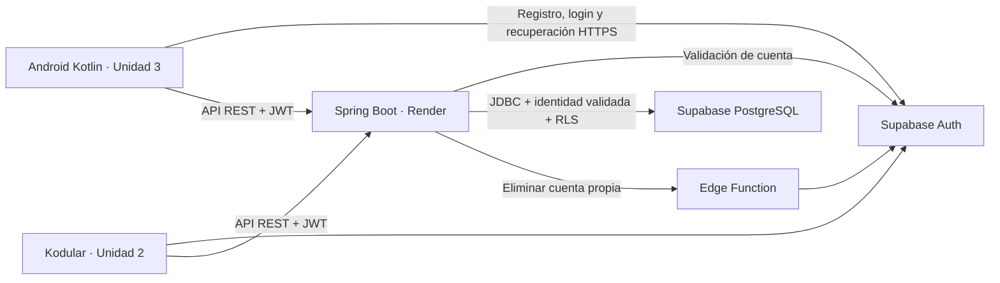
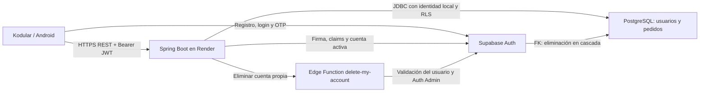

# Gestor de Pedidos

**Universidad de Cartagena · Ingeniería de Software**
**Desarrollador:** Neider Lizcano
**Unidad 3 · Desarrollo de Aplicaciones Móviles · Ejercicio 17 — Pedidos**

Gestor de Pedidos administra pedidos y el perfil propio de cada usuario mediante una API REST. El repositorio conserva dos entregas académicas que comparten el backend Java Spring Boot, Supabase Auth y PostgreSQL en Supabase, con despliegue del backend en Render.

| Componente | Entrega y acceso |
| --- | --- |
| **Unidad 4: Ionic Vue (en desarrollo)** | Ionic Vue 9, TypeScript y Capacitor 8 con arquitectura hexagonal en `mobile/`. [Instalación, variables, pruebas y compilación](#unidad-4--cliente-ionic-vue-mobile). |
| **Unidad 3: Android nativo** | Kotlin, Jetpack Compose y Material 3. [Código, instalación, configuración y pruebas](android/README.md). Abrir `android/` en Android Studio. |
| **Unidad 2: Kodular** | Entrega V9 preservada: [APK](app/GestorPedidos_V9.apk), [fuente AIA](app/GestorPedidos_V9.aia) e [informe histórico](docs/ENTREGA_V9.md). Su documentación completa se conserva más abajo. |
| **Backend compartido** | Spring Boot con arquitectura hexagonal. [Despliegue y ejecución](backend/DESPLIEGUE_RENDER.md), [usuarios](backend/API_USUARIOS.md) y [pedidos](backend/API_PEDIDOS.md). |
| **Base de datos y cuenta** | [Esquema PostgreSQL y RLS](database/schema.sql), [integración JDBC/RLS](backend/INTEGRACION_JDBC_RLS.md) y [eliminación de cuenta](database/DELETE_CUENTA_PROPIA.md). |
| **Reportes** | [API de usuarios](backend/API_REPORTES_USUARIOS.md), [API de pedidos](backend/API_REPORTES_PEDIDOS.md) y [uso desde Android](android/README.md#reportes-parametrizados). |

## Tecnologías y arquitectura compartida

| Área | Tecnologías utilizadas |
| --- | --- |
| Android, Unidad 3 | Kotlin, Android Studio, Jetpack Compose, Material 3, MVVM, ViewModel, StateFlow y corrutinas |
| Comunicación Android | Retrofit, OkHttp y Gson; clientes separados para Auth y Spring |
| Compilación Android | Gradle Wrapper, Kotlin DSL y catálogo de versiones |
| Móvil, Unidad 2 | Kodular, TinyDB, ubicación y acelerómetro |
| Backend | Java 17, Spring Boot 4.1.2, Spring Security, Bean Validation, JDBC y Maven |
| Persistencia y autenticación | PostgreSQL en Supabase, RLS, Supabase Auth/JWT y Edge Function de eliminación |
| Despliegue y verificación | Render, Git/GitHub, Postman, JUnit, Mockito, MockWebServer y AndroidX Test |



Android utiliza MVVM y repositorios. Spring conserva la arquitectura hexagonal: dominio, casos de uso, puertos y adaptadores REST/JDBC/HTTP. Las reglas de negocio y la autorización pertenecen al backend; el móvil no accede directamente a las tablas ni recibe privilegios administrativos.

## Funcionalidades académicas de Unidad 3

| Requisito | Implementación y alcance |
| --- | --- |
| Aplicación Android Studio en Kotlin | Proyecto nativo en `android/`, interfaz Compose y Material 3 |
| Persistencia por API REST y backend en nube | Repositorios Android → Spring Boot en Render → PostgreSQL en Supabase |
| CRUD de dos tablas | Pedidos propios y perfil propio de `usuarios`; sin administración global |
| Dos reportes parametrizados por tabla | Pedidos por estado/fechas y ubicación; perfil por nombre y por correo. La API también admite username |
| Login y recuperación por correo | Supabase Auth REST: registro, login, OTP, cambio de contraseña, sesión y logout |
| Funcionalidades del dispositivo | Acelerómetro y ubicación GPS/asistida. El estudiante confirmó su aceptación docente para esta entrega |
| Atributos del ejercicio 17 | Los 13 atributos de Pedido y la asociación del propietario validado |
| Código y APK público | Código integrado y [APK Debug de Unidad 3](android/apk/GestorPedidos_Unidad3.apk) preparados en este árbol; publicación en GitHub pendiente. V9 se conserva como entrega distinta |
| Evidencias académicas | Validaciones técnicas descritas abajo; capturas Android, video y documento final pendientes de vincular |

La ubicación solo se solicita al pulsar **Usar mi ubicación** en Crear o Actualizar pedido. No se realiza seguimiento en segundo plano. Proximidad no es una funcionalidad activa de la interfaz final.

## Estructura del repositorio

```text
mobile/        Cliente Ionic Vue + Capacitor de Unidad 4, pruebas Vitest
android/       Aplicación Kotlin, recursos, pruebas, Gradle Wrapper y APK en apk/
backend/       Spring Boot hexagonal, pruebas y documentación REST
database/      Esquema PostgreSQL, RLS y documentación de cuenta
supabase/      Edge Function y archivos necesarios de Supabase
app/           Fuentes y APK históricos de Kodular; se preservan V8 y V9
apk/           Reserva anterior; el APK de Unidad 3 está en android/apk/
docs/          Documentación académica e histórica publicable
screenshots/   Evidencias publicadas y revisadas de Unidad 2
```

La documentación privada de coordinación y la configuración local no forman parte del paquete académico.

## Clonar y ejecutar

Repositorio: [neiderlizcano/gestor_pedidos_7502420041](https://github.com/neiderlizcano/gestor_pedidos_7502420041).

```powershell
git clone https://github.com/neiderlizcano/gestor_pedidos_7502420041.git
Set-Location gestor_pedidos_7502420041
```

Los pasos Android requieren una revisión publicada que contenga `android/`. A la fecha de esta documentación, la versión integrada está en la rama local `feature/android-crud`; clonar el `main` público de Unidad 2 no descarga cambios locales aún no publicados.

- **Android:** seguir [requisitos, configuración segura y comandos](android/README.md#instalaci?n-y-compilaci?n). Requiere JDK 25 para Gradle, SDK 37 y Android 8.0/API 26 o superior para instalar.
- **Kodular:** descargar el APK V9 o importar su AIA en Kodular Creator, según la sección histórica.
- **Backend:** Java 17 y Maven. Consultar [variables y despliegue](backend/DESPLIEGUE_RENDER.md). La API persistente requiere el perfil Spring `persistencia` y configuración de servidor autorizada; no es necesario desplegar otro backend para utilizar el servicio existente.
- **Postman:** consultar [contratos, evidencia histórica y preparación de una exportación saneada](android/README.md#api-rest-y-postman). No hay una colección pública exportada enlazada en esta entrega.

Las tres propiedades públicas Android se configuran fuera del repositorio: `GESTOR_AUTH_URL`, `GESTOR_AUTH_PUBLIC_KEY` y `GESTOR_API_URL`. Nunca utilizar claves privilegiadas, contraseñas de base de datos ni tokens personales como configuración de la aplicación.

## Validación y estado de entrega

Registro de suites: **15 de noviembre de 2026, hora de Colombia**. No se repitieron las suites JVM/instrumentadas al preparar la entrega; sí se verificaron compilación, firma, instalación y apertura del APK final.

| Evidencia Android | Resultado y procedencia |
| --- | --- |
| Suite JVM | 310 pruebas, 0 fallos, errores u omisiones; XML locales del 15/11/2026 |
| Instrumentación completa anterior | 77 pruebas aprobadas, según resultado comunicado por el estudiante; no se conserva ese XML completo en la salida actual |
| Regresión posterior al cierre de Lint | 14 pruebas de ubicación y 5 de formularios, 19 aprobadas; XML locales del 15/11/2026 |
| Android Lint | 0 errores y 28 advertencias; informe local del 15/11/2026 |
| Samsung físico | Validación funcional comunicada por el estudiante; no se presenta como una nueva ejecución automatizada |
| APK Debug | assembleDebug satisfactorio en esta preparación; firma v2 e instalación/apertura en emulador verificadas. Publicación pendiente |

Las ejecuciones instrumentadas anteriores y dirigidas no se suman como casos independientes. Los resultados históricos del backend y Kodular se conservan en [ENTREGA_V9.md](docs/ENTREGA_V9.md) y en la sección siguiente; no son pruebas del cliente Kotlin. El [README Android](android/README.md#pruebas-y-evidencias) detalla fechas, alcance y limitaciones.

## APK, capturas y material académico

- **APK nativo preparado:** [GestorPedidos_Unidad3.apk](android/apk/GestorPedidos_Unidad3.apk), versión 0.1.0 (código 1), Android 8.0/API 26+, 11.683.863 bytes y firma Debug v2 verificada. SHA-256: `2c1d3b0009f9297f3b7f54b12591ea416ea2910c10fb0fcb9886e4f1268e2507`. El enlace estará disponible en GitHub después de publicar esta revisión; el commit final de entrega aún no se ha creado.
- **Capturas Android:** pendientes de seleccionar y publicar sin datos personales ni credenciales. Las capturas enlazadas en la sección Kodular pertenecen a Unidad 2.
- **Video Unidad 3:** pendiente de enlace verificable en YouTube o Vimeo; debe mostrar rostro, voz propia, explicación del código y funcionamiento.
- **Word/PDF Unidad 3:** pendiente de archivo público verificado con nombre completo, código estudiantil, correo institucional, ejercicio, actividad y enlaces de repositorio/video.

Los archivos publicables se entregan mediante operaciones Git revisadas. No se incluyen credenciales, sesiones Postman, configuración del equipo ni archivos internos de herramientas.

---

## Unidad 4 — Cliente Ionic Vue (`mobile/`)

Infraestructura inicial del cliente multiplataforma. Por ahora la pantalla de inicio comprueba `GET /actuator/health` del backend en Render y muestra el resultado; las funciones de pedidos y perfil se incorporarán en los siguientes cortes. El proyecto nativo de Capacitor está en `mobile/android/` y es independiente del proyecto Kotlin de Unidad 3 en `android/`.

### Arquitectura

```text
mobile/src/
  domain/        Modelo (ApiStatus), puertos de salida y errores; sin dependencias de frameworks
  application/   Puertos de entrada (casos de uso) y servicios
  adapters/      Implementaciones HTTP de los puertos
  bootstrap/     Configuración de la API y composición de dependencias
  presentation/  App, router, vistas Ionic, tema y mensajes
mobile/tests/    Pruebas unitarias con Vitest
```

### Requisitos

- Node.js 24 (LTS) y npm 11 o superior.
- Para Android: JDK 21, Android SDK con la plataforma 36 (`compileSdk`/`targetSdk` 36, `minSdk` 24) y Android Studio o `adb` para instalar. Detalles en [Compilación Android](#compilación-android-capacitor).

### Instalación

```powershell
Set-Location mobile
npm ci
Copy-Item .env.example .env.local
```

`npm ci` instala exactamente las versiones de `package-lock.json`. El archivo `.env.local` está excluido de Git.

### Variables de entorno

Todas las variables `VITE_*` son públicas: Vite las incrusta en el código compilado. No se deben colocar claves privadas, tokens ni contraseñas.

| Variable | Uso | Valor por defecto |
| --- | --- | --- |
| `VITE_API_BASE_URL` | Base de la API en el navegador. Vacía = mismo origen, atendido por el proxy de Vite | vacía |
| `VITE_NATIVE_API_BASE_URL` | URL HTTPS absoluta del backend para la app nativa; no usa el proxy de Vite | `https://gestor-pedidos-api.onrender.com` |
| `API_PROXY_TARGET` | Destino del proxy de `npm run dev` y `npm run preview`; no llega a la app | `https://gestor-pedidos-api.onrender.com` |

Si `VITE_NATIVE_API_BASE_URL` no es una URL HTTPS absoluta, la app nativa abre igualmente y muestra «Configuración inválida» en lugar de intentar la conexión.

### Ejecución, pruebas y compilación

| Comando | Resultado |
| --- | --- |
| `npm run dev` | Servidor de desarrollo en `http://localhost:5174` con proxy hacia el backend |
| `npm test` | Pruebas unitarias (Vitest) de configuración, adaptador HTTP, servicio y mensajes |
| `npm run typecheck` | Verificación de tipos con `vue-tsc` |
| `npm run build` | Verificación de tipos y compilación web en `mobile/dist/` |
| `npm run preview` | Sirve `dist/` en `http://localhost:4174` con el mismo proxy |

La primera consulta puede tardar mientras Render despierta el servicio gratuito; la app distingue servicio disponible, caído, HTTP 503, HTTP 404, otros códigos HTTP, respuestas no válidas, tiempo agotado y falta de conexión. El plazo de 30 segundos cubre tanto la llegada de las cabeceras como la lectura completa del cuerpo.

### Proxy de desarrollo y despliegue web

- `npm run dev` y `npm run preview` reenvían `/actuator` y `/api` a `API_PROXY_TARGET` mediante el proxy configurado en `vite.config.ts`.
- La compilación estática de `mobile/dist/` no incluye ese proxy: fuera de Vite, una base vacía apunta al mismo servidor que entrega los archivos.
- Un hosting web necesitaría redirigir las rutas de la SPA (`/inicio`, `/acerca`, …) a `index.html` para que recargar o abrir un enlace directo no devuelva 404.
- Las peticiones a la API requerirían un proxy del propio hosting hacia el backend, o bien definir `VITE_API_BASE_URL` con una URL HTTPS absoluta cuyo backend permita ese origen mediante CORS.
- El objetivo principal del Corte 4 es generar la aplicación Android con Capacitor, que usa `VITE_NATIVE_API_BASE_URL` y no depende del proxy. El hosting web público no está configurado todavía.

### Compilación Android (Capacitor)

| Dato | Valor |
| --- | --- |
| Identificador | `com.neiderlizcano.gestorpedidos.ionic` (distinto del APK nativo de Unidad 3) |
| Nombre visible | Gestor de Pedidos |
| Permisos | Solo `INTERNET` |
| Plugins nativos | `@capacitor/app`: botón Atrás del sistema. Ionic lo usa para navegar y, en la pantalla raíz, `App.minimizeApp()` envía la app a segundo plano |
| Herramientas del template | Capacitor 8.6, Android Gradle Plugin 8.13.0 y Gradle Wrapper 8.14.3 |

**JDK:** Capacitor 8 compila con Java 21, y Gradle 8.14.3 solo se ejecuta sobre JDK 17–24. El JDK 25 que incluyen las versiones recientes de Android Studio falla con `Unsupported class file major version 69`, y el JDK 17 no admite el nivel 21. Instalar un JDK 21 (por ejemplo Temurin 21) y apuntar `JAVA_HOME` a él solo en la sesión de compilación. No se debe subir el wrapper a Gradle 9.6, porque AGP 8.13 es incompatible. Si falta la plataforma 36, Gradle la descarga durante la primera compilación.

```powershell
Set-Location mobile
npm.cmd ci
npm.cmd run build
npx.cmd cap sync android
$env:JAVA_HOME = "$env:USERPROFILE\.jdks\jdk-21.0.13.1+2"   # ruta del JDK 21 instalado
$env:ANDROID_HOME = "$env:LOCALAPPDATA\Android\Sdk"
Set-Location android
.\gradlew.bat :app:assembleDebug
```

Pruebas del módulo `:app` (desde `mobile/android`, con las mismas variables de entorno):

```powershell
.\gradlew.bat :app:testDebugUnitTest            # pruebas locales (actualmente sin fuentes)
& "$env:ANDROID_HOME\platform-tools\adb.exe" devices   # debe listar un emulador o dispositivo
.\gradlew.bat :app:connectedDebugAndroidTest    # pruebas instrumentadas en el dispositivo
```

La prueba instrumentada `AppContextInstrumentedTest` verifica que el paquete instalado sea `com.neiderlizcano.gestorpedidos.ionic`. El 25/11/2026 pasó en el AVD API 37 (1 de 1); el informe queda en `app/build/reports/androidTests/connected/debug/`.

Usar siempre el prefijo `:app:`. La tarea global `connectedDebugAndroidTest` también recorre el módulo generado `capacitor-cordova-android-plugins` y falla en `checkDebugAndroidTestDuplicateClasses`: su classpath de pruebas mezcla `kotlin-stdlib` 1.8.22 con `kotlin-stdlib-jdk7/jdk8` 1.6.21. Ese módulo no contiene pruebas y `npx cap sync` lo regenera, por lo que no se modifica.

- La APK queda en `mobile/android/app/build/outputs/apk/debug/app-debug.apk` y está excluida de Git. Para instalarla: `adb install -r` con esa ruta.
- Para abrir el proyecto en Android Studio: `npx.cmd cap open android`. Android Studio crea `local.properties` con la ruta del SDK; ese archivo tampoco se versiona.
- `npx.cmd cap sync android` copia `dist/` a `app/src/main/assets/public` y regenera la configuración nativa. Esos archivos se generan y no se versionan; el resto de `mobile/android/` sí se versiona para que el proyecto sea reproducible.
- Las variables `VITE_*` se fijan al compilar: después de cambiar `.env.local` hay que repetir `npm.cmd run build` y `npx.cmd cap sync android`.

En PowerShell con política `Restricted` no se pueden ejecutar scripts `.ps1`, como `npm.ps1` o `npx.ps1`. Por eso se usan `npm.cmd`, `npx.cmd`, `.\gradlew.bat` y `adb.exe`, que no dependen de esa política.

### Solicitudes HTTP en Android y CORS

- `capacitor.config.ts` activa `CapacitorHttp`. Dentro de la app, `fetch` se reemplaza por una solicitud nativa de Android, sin pasar por las reglas CORS del WebView. En el emulador, logcat lo confirma con `Handling CapacitorHttp request: …/_capacitor_http_interceptor_?u=https://gestor-pedidos-api.onrender.com/actuator/health`.
- Esto es necesario. En una prueba del 24/11/2026, el backend en Render no devolvió cabeceras `Access-Control-Allow-*` para ningún origen probado: `https://localhost` (el origen del WebView), `http://localhost:5174` y uno ajeno. Además, el preflight `OPTIONS` respondió 401. Un `fetch` del WebView sin `CapacitorHttp` sería bloqueado.
- El servidor de desarrollo web no tiene este problema porque usa el proxy de Vite.
- **Arranque en frío medido** en la misma fecha desde un equipo de escritorio, no desde la app:
  - Primer intento: sin respuesta en 90 s.
  - Segundo intento: HTTP 200 `UP` en unos 20 s.
  - Siguientes intentos: unos 0,5 s.
- La app espera 30 s, así que durante un arranque en frío lo esperable es «Tiempo de espera agotado», y un nuevo intento debería responder.
- Spring Security responde 401 a rutas desconocidas, así que una URL base equivocada dentro del mismo backend aparece como «Error del servidor (HTTP 401)» y no como 404.

### Verificación en emulador (24/11/2026)

Prueba con la APK debug en el AVD `Medium_Phone_API_37.0` (Android API 37) contra Render real:

| Escenario | Resultado observado |
| --- | --- |
| Servicio activo | «Disponible», HTTP 200, entre 515 y 1690 ms. El servicio ya estaba despierto, así que no se observó un arranque en frío desde la app |
| Wifi y datos desactivados | «Sin conexión», sin tiempo de respuesta; la región accesible anuncia el mensaje |
| Host no enrutable (compilación temporal con `VITE_NATIVE_API_BASE_URL=https://10.255.255.1`) | Android abandona la conexión a los ~21 s (`Failed to connect`) y la app muestra «Sin conexión» antes del plazo de 30 s |
| Latencia de 40 s con `adb emu network delay` | La imagen API 37 no aplicó la latencia, así que no sirvió para provocar el tiempo agotado |
| Navegación | Inicio → «Acerca de» → el botón «Volver» de la barra regresa a Inicio, igual que el botón Atrás del sistema. En Inicio, Atrás pasa la app a segundo plano sin cerrarla y al reabrirla conserva el estado |

- El estado «Tiempo de espera agotado» (servidor que acepta la conexión pero tarda más de 30 s) está cubierto por las pruebas unitarias. No se reprodujo en el dispositivo.
- La interceptación de `CapacitorHttp` no recibe el `AbortSignal`: la app informa el tiempo agotado a los 30 s, pero la solicitud nativa puede seguir abierta hasta que Android la cierre.

---

## Unidad 2 — Entrega académica Kodular V9

El contenido siguiente conserva la documentación de Unidad 2 y sus atribuciones. Las características, requisitos de Android, versiones, capturas, límites de seguridad y resultados de V9 se refieren exclusivamente al APK Kodular, no a la aplicación Kotlin de Unidad 3.

**Universidad de Cartagena · Ingeniería de Software**

**Desarrollador:** Neider Lizcano

**Entrega académica:** V9

Aplicación Android desarrollada en Kodular para administrar pedidos y el perfil
propio de cada usuario. Integra un backend Java Spring Boot con arquitectura
hexagonal, alojado en Render, con Supabase Auth y PostgreSQL protegido mediante RLS.

### Objetivo

Facilitar el registro, seguimiento, consulta y actualización de pedidos, manteniendo
separadas la interfaz móvil, las reglas de negocio, la autenticación y la persistencia.
Cada usuario opera exclusivamente sobre sus recursos.

### Archivos finales

| Archivo | Uso |
| --- | --- |
| [GestorPedidos_V9.apk](app/GestorPedidos_V9.apk) | Aplicación Android instalable |
| [GestorPedidos_V9.aia](app/GestorPedidos_V9.aia) | Proyecto fuente importable en Kodular Creator |
| [Informe de entrega V9](docs/ENTREGA_V9.md) | Hashes, integridad, firma, evidencias y limitaciones |

**V9 es el nombre de esta entrega**, no la versión interna de Android: ambos
artefactos conservan `versionName=1.0` y `versionCode=1`. El nombre interno del
proyecto Kodular es `GestorPedidos_FINAL_V2`. El APK requiere Android 6.0/API 23 o
superior y declara target API 36. Las versiones V8 se conservan como antecedentes.

### Funcionalidades implementadas

- Registro e inicio de sesión con Supabase Auth, renovación de sesión y cierre de sesión.
- Recuperación de contraseña: solicitud por correo, verificación del código OTP y
  actualización de la contraseña mediante Supabase Auth.
- Creación y consulta del perfil propio; actualización de nombre y username.
- Eliminación de la cuenta propia, con confirmación y borrado en cascada de perfil
  y pedidos. No es una eliminación aislada del perfil ni una operación reversible.
- CRUD de pedidos: crear, listar, consultar, editar y eliminar pedidos propios.
- Validación de fechas e importes: valor positivo, propina no negativa y fechas ordenadas.
- Cuatro reportes parametrizados, descritos en la tabla siguiente.
- Sensor de ubicación para asistir el registro de la ubicación del pedido.
- Acelerómetro para solicitar la actualización del listado de pedidos mediante movimiento.
- TinyDB para estado local de interfaz y datos de perfil; no se utiliza como fuente
  de autorización ni como base de datos de pedidos.

#### Reportes

Todos se limitan a los datos del usuario autenticado; no ofrecen búsqueda global de personas.

| Reporte | Parámetros principales | Resultado |
| --- | --- | --- |
| Perfil por nombre o username | `campo`, `termino`, `coincidencia` (`exacta`/`prefijo`) | Cero o un perfil propio |
| Perfil por correo | `correo` | Cero o un perfil propio |
| Pedidos por estado y fechas | `estado`, `desde`, `hasta`, `fechaBase` | Pedidos propios paginados |
| Pedidos por ubicación | `pais`, `departamento`, `ciudad`; al menos uno | Pedidos propios paginados |

Los reportes de pedidos admiten `pagina` desde cero y `tamano` entre 1 y 100.
Devuelven `contenido`, `pagina`, `tamano` y `haySiguiente`, sin totales agregados.

### Tecnologías

| Capa | Tecnologías |
| --- | --- |
| Aplicación móvil | Kodular, Android, TinyDB, Location Sensor y Accelerometer Sensor |
| Backend | Java 17, Spring Boot, Spring Security, Bean Validation y JDBC |
| Autenticación | Supabase Auth, JWT ES256 y recuperación por OTP |
| Persistencia | Supabase PostgreSQL, claves foráneas, restricciones e índices, RLS |
| Eliminación de cuenta | Supabase Edge Function `delete-my-account` y Auth Admin |
| Alojamiento y herramientas | Render, Maven, JUnit, Mockito, Postman, Git y GitHub |

### Arquitectura e integración



El backend organiza los módulos `usuarios`, `pedidos` y `reportes` siguiendo
arquitectura hexagonal:

- **Dominio:** entidades y reglas de negocio, sin dependencias de HTTP ni Supabase.
- **Aplicación:** casos de uso y puertos de entrada/salida.
- **Adaptadores de entrada:** controladores REST y validación de solicitudes.
- **Adaptadores de salida:** repositorios JDBC, consultas de reportes e integración HTTP con Auth/Edge.
- **Configuración:** cableado de dependencias, Spring Security y contexto RLS por transacción.

Kodular obtiene la sesión en Supabase Auth y envía el JWT al backend. Las
operaciones de negocio se realizan mediante la API Spring, no mediante acceso
administrativo desde el móvil. La aplicación no es un proyecto Android/Gradle:
su fuente móvil es el archivo `.aia`; el `.apk` es el artefacto compilado.

#### API de negocio

| Recurso | Operaciones implementadas |
| --- | --- |
| Perfil propio | `POST /api/v1/usuarios`; `GET`, `PUT`, `DELETE /api/v1/usuarios/me` |
| Pedidos | `POST`, `GET /api/v1/pedidos`; `GET`, `PUT`, `DELETE /api/v1/pedidos/{id}` |
| Reportes | `GET /api/v1/reportes/usuarios/nombre-username`, `/usuarios/correo`, `/pedidos/estado-fechas`, `/pedidos/ubicacion` bajo `/api/v1/reportes` |
| Salud | `GET /actuator/health`, público y sin detalles internos |

La gestión de usuarios se limita a la **cuenta propia**: no hay CRUD administrativo
ni listado global de usuarios. POST/PUT de perfil reciben solo username y nombre;
la identidad y el correo proceden del JWT. Las contraseñas pertenecen a Supabase
Auth, no a `public.usuarios` ni al DTO de perfil.

### Autenticación y seguridad

- Spring Security valida firma ES256, emisor, expiración, audiencia, rol y UUID del JWT.
- `CuentaActivaFiltro` comprueba la cuenta mediante `GET /auth/v1/user` después de
  validar el JWT y antes de ejecutar el endpoint protegido; compara el ID con `sub`.
- No hay caché de cuentas activas. Una cuenta eliminada/no autorizada se rechaza
  con HTTP 401; un fallo de disponibilidad de Auth bloquea el acceso con HTTP 503.
- El backend obtiene el propietario del contexto validado, no de IDs suministrados
  por el cliente. JDBC aplica filtros de propietario y contexto RLS transaccional.
- Las políticas usan `usuarios.id = auth.uid()` y `pedidos.usuario_id = auth.uid()`.
  Las FK hacia `auth.users` eliminan los datos asociados al borrar la cuenta.
- La clave Supabase **publishable** incluida en el cliente es pública: no equivale
  a `service_role`, una clave secreta o una contraseña de base de datos.
- `CUENTA_PUBLISHABLE_KEY` sigue siendo compatible con el backend mediante
  `cuenta.publishable-key`; no es obligatorio agregar `SUPABASE_PUBLISHABLE_KEY`.

Estos controles no sustituyen una auditoría dinámica del móvil. El APK permite
HTTP sin cifrar y exporta sus actividades; el almacenamiento interno del SDK Auth
y sus copias de seguridad no están certificados por esta revisión. Los destinos
de integración encontrados son HTTPS. Consulte los límites en el informe V9.

### Instalación y uso

#### Requisitos

- Android 6.0/API 23 o superior y espacio suficiente para la instalación.
- Acceso a Internet y disponibilidad de Render/Supabase para operaciones remotas.
- Permiso de ubicación si se desea utilizar esa asistencia del dispositivo.
- Permiso de instalación desde la fuente de descarga elegida, solo para el APK confiable.

#### Pasos

1. Descargar el APK del enlace de archivos finales y comprobar su SHA-256 con el
   publicado en el informe V9. No desinstalar una versión con datos reales para
   resolver una actualización sin revisar antes compatibilidad y respaldo.
2. Instalarlo siguiendo las indicaciones de Android. No requiere instalar Java o Maven.
3. Registrarse e iniciar sesión; completar la confirmación por correo si la
   configuración de Supabase la solicita. Completar el perfil cuando corresponda.
4. Crear pedidos y gestionarlos desde **Mis pedidos**. Utilizar los filtros de reportes.
5. Desde el perfil, actualizar los datos propios o solicitar la eliminación de cuenta.
6. Para recuperar acceso, solicitar el código por correo y completar el flujo OTP.
7. Cerrar sesión al terminar. No compartir contraseñas, códigos OTP ni JWT.

**La entrega apunta a producción.** No ejecutar pruebas destructivas ni eliminar
cuentas de otras personas. Las pruebas técnicas deben emplear entornos aislados
y cuentas ficticias autorizadas.

Para revisar el código móvil, importar el AIA como proyecto separado en Kodular
Creator, sin sobrescribir el original. La compilación móvil se realiza allí.
Para requisitos de ejecución del backend, consultar su documentación específica;
no se requieren herramientas de desarrollo para utilizar el APK.

### Capturas de pantalla

Solo se publican capturas sin datos personales ni credenciales. Las restantes
permanecen fuera del repositorio hasta su saneamiento o autorización expresa.

| Captura | Contenido |
| --- | --- |
| [Reporte parametrizado por ubicación](screenshots/04_reportes.jpeg) | Filtro por país y resultado de un pedido de prueba: ID, fecha, estado, ciudad y valor; sin nombre ni correo |
| [Recuperación mediante OTP](screenshots/05_01_recuperacion.jpeg) | Diálogo de recuperación; no muestra correo, código OTP, contraseña ni JWT |

Las capturas de inicio, listado, perfil y recuperación con correo visible no se
incluyen porque contienen datos personales o no coinciden con el contenido
declarado. No se modificaron; requieren una versión saneada o autorización expresa.

### Estructura del repositorio

```text
app/                    AIA y APK; V9 es la entrega final, V8 se conserva
backend/                Backend hexagonal, pruebas y documentación técnica
database/               Esquema SQL, políticas RLS y documentación de eliminación
supabase/               Código y configuración de la Edge Function
docs/ENTREGA_V9.md      Registro académico/técnico de esta entrega
docs/historico/          Documentación histórica; NO_EJECUTAR no son migraciones activas
screenshots/            Capturas de evidencia; solo se publican las sanitizadas
```

No forman parte de la entrega los candidatos y diagnósticos de `app/salida/`,
archivos Postman locales con sesiones, `.env`, certificados ni configuración del
asistente. No utilizar inclusiones globales de Git para publicar esta entrega.

### Estado de validación y evidencias

- **Android V9:** el responsable confirmó que probó todas las funciones
  satisfactoriamente. Es una prueba declarada por el usuario, no repetida por el agente.
- **Backend:** suite local completa de 834 pruebas aprobadas; después del ajuste
  final de inyección HTTP se aprobaron 180 pruebas relacionadas. Son ejecuciones
  diferentes, no 1.014 casos independientes ni una nueva suite completa posterior.
- **Supabase real de pruebas:** el usuario comunicó éxito de las dos pruebas
  optativas del adaptador: cuenta activa y cuenta eliminada, una prueba cada una.
- **Integridad y firma:** ZIP/CRC de ambos artefactos correcto; `apksigner` de
  Android SDK Build Tools 36.0.0 verificó las firmas v1, v2 y v3 con código 0.
  v3.1 y v4 no están verificadas; dos entradas `META-INF/services` de Kotlin no
  están cubiertas por la firma JAR/v1. No se declara análisis antimalware ni
  certificación completa.
- **Capturas:** dos capturas sanitizadas integradas; las demás requieren
  saneamiento o autorización antes de publicarse.
- **Producción:** el usuario confirmó integración del PR #13 y despliegue correcto
  en Render. No se reprodujeron operaciones productivas durante esta preparación.

El detalle, la procedencia de cada evidencia y las limitaciones se encuentran en
[ENTREGA_V9.md](docs/ENTREGA_V9.md). Parte de la documentación previa del backend
conserva estados históricos; no debe interpretarse como una nueva ejecución.

#### Referencias técnicas

- [API de usuarios](backend/API_USUARIOS.md) y [API de pedidos](backend/API_PEDIDOS.md).
- [Reportes de usuarios](backend/API_REPORTES_USUARIOS.md) y [reportes de pedidos](backend/API_REPORTES_PEDIDOS.md).
- [Cuenta activa y JWT](backend/VALIDACION_CUENTA_ACTIVA.md).
- [Integración JDBC/RLS](backend/INTEGRACION_JDBC_RLS.md).
- [Eliminación de cuenta propia](database/DELETE_CUENTA_PROPIA.md).
- [Despliegue en Render](backend/DESPLIEGUE_RENDER.md).
