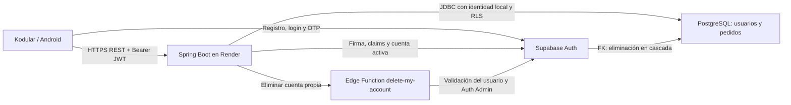

# Gestor de Pedidos — Actividad 2

**Universidad de Cartagena · Ingeniería de Software**

**Desarrollador:** Neider Lizcano

**Entrega académica:** V9

Aplicación Android desarrollada en Kodular para administrar pedidos y el perfil
propio de cada usuario. Integra un backend Java Spring Boot con arquitectura
hexagonal, alojado en Render, con Supabase Auth y PostgreSQL protegido mediante RLS.

## Objetivo

Facilitar el registro, seguimiento, consulta y actualización de pedidos, manteniendo
separadas la interfaz móvil, las reglas de negocio, la autenticación y la persistencia.
Cada usuario opera exclusivamente sobre sus recursos.

## Archivos finales

| Archivo | Uso |
| --- | --- |
| [GestorPedidos_V9.apk](app/GestorPedidos_V9.apk) | Aplicación Android instalable |
| [GestorPedidos_V9.aia](app/GestorPedidos_V9.aia) | Proyecto fuente importable en Kodular Creator |
| [Informe de entrega V9](docs/ENTREGA_V9.md) | Hashes, integridad, firma, evidencias y limitaciones |

**V9 es el nombre de esta entrega**, no la versión interna de Android: ambos
artefactos conservan `versionName=1.0` y `versionCode=1`. El nombre interno del
proyecto Kodular es `GestorPedidos_FINAL_V2`. El APK requiere Android 6.0/API 23 o
superior y declara target API 36. Las versiones V8 se conservan como antecedentes.

## Funcionalidades implementadas

- Registro e inicio de sesión con Supabase Auth, renovación de sesión y cierre de sesión.
- Recuperación de contraseña: solicitud por correo, verificación del código OTP y
  actualización de la contraseña mediante Supabase Auth.
- Creación y consulta del perfil propio; actualización de nombre y username.
- Eliminación de la cuenta propia, con confirmación y borrado en cascada de perfil
  y pedidos. No es una eliminación aislada del perfil ni una operación reversible.
- CRUD de pedidos: crear, listar, consultar, editar y eliminar pedidos propios.
- Validación de fechas e importes: valor positivo, propina no negativa y fechas ordenadas.
- Cuatro reportes parametrizados, descritos en la tabla siguiente.
- Sensor de ubicación para asistir el registro de la ubicación del pedido.
- Acelerómetro para solicitar la actualización del listado de pedidos mediante movimiento.
- TinyDB para estado local de interfaz y datos de perfil; no se utiliza como fuente
  de autorización ni como base de datos de pedidos.

### Reportes

Todos se limitan a los datos del usuario autenticado; no ofrecen búsqueda global de personas.

| Reporte | Parámetros principales | Resultado |
| --- | --- | --- |
| Perfil por nombre o username | `campo`, `termino`, `coincidencia` (`exacta`/`prefijo`) | Cero o un perfil propio |
| Perfil por correo | `correo` | Cero o un perfil propio |
| Pedidos por estado y fechas | `estado`, `desde`, `hasta`, `fechaBase` | Pedidos propios paginados |
| Pedidos por ubicación | `pais`, `departamento`, `ciudad`; al menos uno | Pedidos propios paginados |

Los reportes de pedidos admiten `pagina` desde cero y `tamano` entre 1 y 100.
Devuelven `contenido`, `pagina`, `tamano` y `haySiguiente`, sin totales agregados.

## Tecnologías

| Capa | Tecnologías |
| --- | --- |
| Aplicación móvil | Kodular, Android, TinyDB, Location Sensor y Accelerometer Sensor |
| Backend | Java 17, Spring Boot, Spring Security, Bean Validation y JDBC |
| Autenticación | Supabase Auth, JWT ES256 y recuperación por OTP |
| Persistencia | Supabase PostgreSQL, claves foráneas, restricciones e índices, RLS |
| Eliminación de cuenta | Supabase Edge Function `delete-my-account` y Auth Admin |
| Alojamiento y herramientas | Render, Maven, JUnit, Mockito, Postman, Git y GitHub |

## Arquitectura e integración



El backend organiza los módulos `usuarios`, `pedidos` y `reportes` siguiendo
arquitectura hexagonal:

- **Dominio:** entidades y reglas de negocio, sin dependencias de HTTP ni Supabase.
- **Aplicación:** casos de uso y puertos de entrada/salida.
- **Adaptadores de entrada:** controladores REST y validación de solicitudes.
- **Adaptadores de salida:** repositorios JDBC, consultas de reportes e integración HTTP con Auth/Edge.
- **Configuración:** cableado de dependencias, Spring Security y contexto RLS por transacción.

Kodular obtiene la sesión en Supabase Auth y envía el JWT al backend. Las
operaciones de negocio se realizan mediante la API Spring, no mediante acceso
administrativo desde el móvil. La aplicación no es un proyecto Android/Gradle:
su fuente móvil es el archivo `.aia`; el `.apk` es el artefacto compilado.

### API de negocio

| Recurso | Operaciones implementadas |
| --- | --- |
| Perfil propio | `POST /api/v1/usuarios`; `GET`, `PUT`, `DELETE /api/v1/usuarios/me` |
| Pedidos | `POST`, `GET /api/v1/pedidos`; `GET`, `PUT`, `DELETE /api/v1/pedidos/{id}` |
| Reportes | `GET /api/v1/reportes/usuarios/nombre-username`, `/usuarios/correo`, `/pedidos/estado-fechas`, `/pedidos/ubicacion` bajo `/api/v1/reportes` |
| Salud | `GET /actuator/health`, público y sin detalles internos |

La gestión de usuarios se limita a la **cuenta propia**: no hay CRUD administrativo
ni listado global de usuarios. POST/PUT de perfil reciben solo username y nombre;
la identidad y el correo proceden del JWT. Las contraseñas pertenecen a Supabase
Auth, no a `public.usuarios` ni al DTO de perfil.

## Autenticación y seguridad

- Spring Security valida firma ES256, emisor, expiración, audiencia, rol y UUID del JWT.
- `CuentaActivaFiltro` comprueba la cuenta mediante `GET /auth/v1/user` después de
  validar el JWT y antes de ejecutar el endpoint protegido; compara el ID con `sub`.
- No hay caché de cuentas activas. Una cuenta eliminada/no autorizada se rechaza
  con HTTP 401; un fallo de disponibilidad de Auth bloquea el acceso con HTTP 503.
- El backend obtiene el propietario del contexto validado, no de IDs suministrados
  por el cliente. JDBC aplica filtros de propietario y contexto RLS transaccional.
- Las políticas usan `usuarios.id = auth.uid()` y `pedidos.usuario_id = auth.uid()`.
  Las FK hacia `auth.users` eliminan los datos asociados al borrar la cuenta.
- La clave Supabase **publishable** incluida en el cliente es pública: no equivale
  a `service_role`, una clave secreta o una contraseña de base de datos.
- `CUENTA_PUBLISHABLE_KEY` sigue siendo compatible con el backend mediante
  `cuenta.publishable-key`; no es obligatorio agregar `SUPABASE_PUBLISHABLE_KEY`.

Estos controles no sustituyen una auditoría dinámica del móvil. El APK permite
HTTP sin cifrar y exporta sus actividades; el almacenamiento interno del SDK Auth
y sus copias de seguridad no están certificados por esta revisión. Los destinos
de integración encontrados son HTTPS. Consulte los límites en el informe V9.

## Instalación y uso

### Requisitos

- Android 6.0/API 23 o superior y espacio suficiente para la instalación.
- Acceso a Internet y disponibilidad de Render/Supabase para operaciones remotas.
- Permiso de ubicación si se desea utilizar esa asistencia del dispositivo.
- Permiso de instalación desde la fuente de descarga elegida, solo para el APK confiable.

### Pasos

1. Descargar el APK del enlace de archivos finales y comprobar su SHA-256 con el
   publicado en el informe V9. No desinstalar una versión con datos reales para
   resolver una actualización sin revisar antes compatibilidad y respaldo.
2. Instalarlo siguiendo las indicaciones de Android. No requiere instalar Java o Maven.
3. Registrarse e iniciar sesión; completar la confirmación por correo si la
   configuración de Supabase la solicita. Completar el perfil cuando corresponda.
4. Crear pedidos y gestionarlos desde **Mis pedidos**. Utilizar los filtros de reportes.
5. Desde el perfil, actualizar los datos propios o solicitar la eliminación de cuenta.
6. Para recuperar acceso, solicitar el código por correo y completar el flujo OTP.
7. Cerrar sesión al terminar. No compartir contraseñas, códigos OTP ni JWT.

**La entrega apunta a producción.** No ejecutar pruebas destructivas ni eliminar
cuentas de otras personas. Las pruebas técnicas deben emplear entornos aislados
y cuentas ficticias autorizadas.

Para revisar el código móvil, importar el AIA como proyecto separado en Kodular
Creator, sin sobrescribir el original. La compilación móvil se realiza allí.
Para requisitos de ejecución del backend, consultar su documentación específica;
no se requieren herramientas de desarrollo para utilizar el APK.

## Capturas de pantalla

Solo se publican capturas sin datos personales ni credenciales. Las restantes
permanecen fuera del repositorio hasta su saneamiento o autorización expresa.

| Captura | Contenido |
| --- | --- |
| [Reporte parametrizado por ubicación](screenshots/04_reportes.jpeg) | Filtro por país y resultado de un pedido de prueba: ID, fecha, estado, ciudad y valor; sin nombre ni correo |
| [Recuperación mediante OTP](screenshots/05_01_recuperacion.jpeg) | Diálogo de recuperación; no muestra correo, código OTP, contraseña ni JWT |

Las capturas de inicio, listado, perfil y recuperación con correo visible no se
incluyen porque contienen datos personales o no coinciden con el contenido
declarado. No se modificaron; requieren una versión saneada o autorización expresa.

## Estructura del repositorio

```text
app/                    AIA y APK; V9 es la entrega final, V8 se conserva
backend/                Backend hexagonal, pruebas y documentación técnica
database/               Esquema SQL, políticas RLS y documentación de eliminación
supabase/               Código y configuración de la Edge Function
docs/ENTREGA_V9.md      Registro académico/técnico de esta entrega
docs/historico/          Documentación histórica; NO_EJECUTAR no son migraciones activas
screenshots/            Capturas de evidencia; solo se publican las sanitizadas
```

No forman parte de la entrega los candidatos y diagnósticos de `app/salida/`,
archivos Postman locales con sesiones, `.env`, certificados ni configuración del
asistente. No utilizar inclusiones globales de Git para publicar esta entrega.

## Estado de validación y evidencias

- **Android V9:** el responsable confirmó que probó todas las funciones
  satisfactoriamente. Es una prueba declarada por el usuario, no repetida por el agente.
- **Backend:** suite local completa de 834 pruebas aprobadas; después del ajuste
  final de inyección HTTP se aprobaron 180 pruebas relacionadas. Son ejecuciones
  diferentes, no 1.014 casos independientes ni una nueva suite completa posterior.
- **Supabase real de pruebas:** el usuario comunicó éxito de las dos pruebas
  optativas del adaptador: cuenta activa y cuenta eliminada, una prueba cada una.
- **Integridad y firma:** ZIP/CRC de ambos artefactos correcto; `apksigner` de
  Android SDK Build Tools 36.0.0 verificó las firmas v1, v2 y v3 con código 0.
  v3.1 y v4 no están verificadas; dos entradas `META-INF/services` de Kotlin no
  están cubiertas por la firma JAR/v1. No se declara análisis antimalware ni
  certificación completa.
- **Capturas:** dos capturas sanitizadas integradas; las demás requieren
  saneamiento o autorización antes de publicarse.
- **Producción:** el usuario confirmó integración del PR #13 y despliegue correcto
  en Render. No se reprodujeron operaciones productivas durante esta preparación.

El detalle, la procedencia de cada evidencia y las limitaciones se encuentran en
[ENTREGA_V9.md](docs/ENTREGA_V9.md). Parte de la documentación previa del backend
conserva estados históricos; no debe interpretarse como una nueva ejecución.

### Referencias técnicas

- [API de usuarios](backend/API_USUARIOS.md) y [API de pedidos](backend/API_PEDIDOS.md).
- [Reportes de usuarios](backend/API_REPORTES_USUARIOS.md) y [reportes de pedidos](backend/API_REPORTES_PEDIDOS.md).
- [Cuenta activa y JWT](backend/VALIDACION_CUENTA_ACTIVA.md).
- [Integración JDBC/RLS](backend/INTEGRACION_JDBC_RLS.md).
- [Eliminación de cuenta propia](database/DELETE_CUENTA_PROPIA.md).
- [Despliegue en Render](backend/DESPLIEGUE_RENDER.md).
