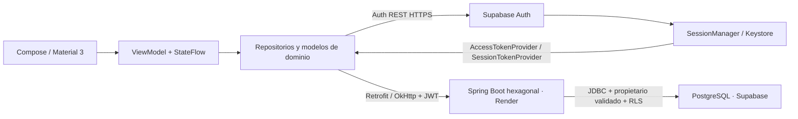

# Gestor de Pedidos — Android nativo

**Universidad de Cartagena · Unidad 3 · Desarrollo de Aplicaciones Móviles**
**Ejercicio 17 — Pedidos · Desarrollador: Neider Lizcano**

Aplicación Android nativa para administrar pedidos y el perfil propio, consultar cuatro reportes y utilizar acelerómetro y ubicación. Reutiliza el backend Spring Boot de Unidad 2, Supabase Auth y PostgreSQL con RLS. La entrega Kodular se conserva separada en el repositorio.

## Funcionalidades

- Registro, login, confirmación de correo cuando Supabase la requiere, recuperación por correo/OTP y logout.
- Restauración y renovación de sesión, manejo de errores y reintentos explícitos controlados.
- **Mi perfil:** consultar, crear explícitamente tras un 404, editar nombre/username y eliminar la cuenta propia con confirmación. El correo es de solo lectura.
- **Mis pedidos:** listar, consultar, crear, editar y eliminar pedidos propios; formularios con calendario, errores por campo y barra de desplazamiento arrastrable.
- Cuatro reportes parametrizados: pedidos por estado/fechas y ubicación, perfil por nombre y por correo.
- Acelerómetro con lecturas reales y estados de disponibilidad; ubicación solicitada exclusivamente mediante **Usar mi ubicación** al crear/editar.
- Borradores y ViewModels aislados por sesión: sobreviven a rotación; se descartan al cerrar sesión o cambiar de cuenta.

Según la confirmación del estudiante, el profesor aceptó acelerómetro y ubicación como las dos funcionalidades requeridas. Proximidad fue retirada de la interfaz por su comportamiento en el Samsung y **no se presenta como funcionalidad activa**. La recepción de lecturas GPS depende del dispositivo y sus proveedores de ubicación.

## Tecnologías y versiones

Versiones verificadas en el catálogo Gradle, la configuración del módulo y el POM del backend:

| Componente | Versión/configuración |
| --- | --- |
| Gradle Wrapper / Android Gradle Plugin | 9.6.0 / 9.5.1 |
| Kotlin / Compose Compiler | 2.2.10 / plugin Compose 2.2.10 |
| Compose BOM / interfaz | 2025.04.01 / Jetpack Compose y Material 3 |
| Activity / Lifecycle | 1.10.1 / 2.9.0 |
| Corrutinas | 1.10.2 |
| Retrofit / OkHttp / Gson | 2.11.0 / 4.12.0 / 2.11.0 |
| JUnit | 4.13.2 |
| AndroidX Test Runner / extensión JUnit | 1.7.0 / 1.3.0 |
| Espresso | 3.7.0, solo para instrumentación |
| JVM de Gradle | JDK 25; entorno verificado anteriormente con JetBrains 25.0.4 |
| Bytecode Java/Kotlin | 17; no equivale a ejecutar Gradle con JDK 17 |
| Android SDK | compileSdk 37, targetSdk 37, minSdk 26 |
| Aplicación | versionName 0.1.0, versionCode 1 |
| Backend compartido | Java 17, Spring Boot 4.1.2, Maven, JDBC y Spring Security |

Proyecto con Gradle Kotlin DSL y un único módulo `app`. Las versiones se centralizan en [libs.versions.toml](gradle/libs.versions.toml). El daemon requiere JDK 25 instalado localmente; no configura aprovisionamiento automático. El entorno validado dispone de Build Tools 36.0.0; el DSL no fija `buildToolsVersion`.

Identificador y namespace: `com.neiderlizcano.gestorpedidos.nativo`. Requiere **Android 8.0/API 26 o superior**. Su paquete es independiente del APK Kodular.

## Arquitectura y paquetes



Spring conserva las reglas de negocio, autorización y arquitectura hexagonal; Android anticipa errores de formulario sin reemplazar la validación del servidor. El cliente no utiliza SQL directo ni privilegios administrativos.

Paquetes bajo `app/src/main/java/com/neiderlizcano/gestorpedidos/nativo/`:

| Paquete | Responsabilidad y clases principales |
| --- | --- |
| raíz y `di` | `GestorPedidosApplication`, `MainActivity`, configuración pública, `AndroidAuthModule` y `AppContainer` |
| `domain` | Modelos e interfaces de Auth, usuarios, pedidos y reportes |
| `data/auth` | `AuthApi`, `RestAuthRepository`, `SessionManager` y recuperación aislada |
| `data/remote` | APIs Retrofit, DTO y mapeadores; fechas ISO e importes BigDecimal |
| `data/repository` | Adaptadores HTTP de usuarios, pedidos y reportes |
| `core/network`, `core/result` | Clientes, ejecutor HTTP y resultados/errores tipados |
| `core/session` | Proveedores de credenciales y almacenamiento cifrado de sesión |
| `ui/auth` | `AuthViewModel`, formularios, `SessionContent` y `SessionDashboard` |
| `ui/pedidos`, `ui/perfil` | Pantallas CRUD, validaciones, borradores y ViewModels |
| `ui/reportes` | Cuatro pantallas, filtros, paginación y ViewModels de reportes |
| `sensores` | Fuente de eventos, hardware Android y ViewModel del acelerómetro |
| `ubicacion` | Obtención puntual de posición, geocodificación inversa y sugerencias de dirección |
| `ui/theme`, `ui/components` | Tema y componentes visuales compartidos |

Las pruebas JVM están en `app/src/test/`; las instrumentadas en `app/src/androidTest/`.

## Autenticación, sesión y recuperación

1. **Registro:** correo, contraseña y confirmación. Si Supabase no devuelve sesión, se informa que puede requerirse confirmar el correo y se permite volver al login. No se crea automáticamente el perfil Spring.
2. **Login:** validación junto a cada campo, carga y bloqueo de envíos simultáneos; errores remotos en español sin exponer respuestas sensibles.
3. **Restauración:** `SessionManager.inicializar()` restaura o renueva antes de habilitar contenido privado. Reintentar la restauración no equivale a reenviar un formulario.
4. **Recuperación:** correo → código OTP de tipo `recovery` → contraseña confirmada → login. La credencial de recuperación se mantiene separada de la sesión normal.
5. **Logout:** limpieza local y revocación remota cuando es posible. Si la revocación no se confirma, se informa sin mantener abierta la sesión local.

### Persistencia y aislamiento

La sesión se cifra con AES-GCM mediante una clave no exportable de Android Keystore, nonce nuevo, escritura atómica y almacenamiento en `noBackupFilesDir`. No se guardan contraseñas ni OTP en disco. El manifiesto desactiva las copias de seguridad de la aplicación.

Los campos sensibles de Auth se conservan durante rotación en memoria del ViewModel, nunca en Bundle o SavedStateHandle. Se limpian al cambiar de flujo, autenticar, cerrar sesión o destruir definitivamente el ViewModel.

`SessionContent` proporciona un almacén de ViewModels por usuario y generación de interfaz. Pedidos, perfil y reportes están dentro del ámbito autenticado. Rotar conserva estado; logout o cambio de cuenta descartan el almacén anterior y las respuestas tardías no deben afectar a otra cuenta. Los borradores no sobreviven a la muerte del proceso.

### JWT, renovación y solicitudes inciertas

- Auth y Spring utilizan clientes HTTPS separados; `apikey` pertenece a Auth y Spring recibe el Bearer JWT del usuario.
- Un 401 de Spring puede forzar una renovación coordinada. Las lecturas GET permiten un único reintento explícitamente habilitado.
- POST, PUT y DELETE no se repiten automáticamente: la renovación sirve para futuras operaciones.
- Un fallo temporal no equivale a revocación. Un refresh con resultado incierto no reutiliza automáticamente su refresh token, que podría haberse consumido.
- Una escritura incierta conserva el borrador y bloquea nuevas escrituras hasta consultar correctamente su estado. El usuario debe verificar si la operación se aplicó antes de repetirla; esto no ofrece idempotencia del servidor.
- Un rechazo de sesión en una escritura no hace que el ViewModel cierre la sesión automáticamente.

## CRUD de usuarios y pedidos

### Mi perfil

Solo se administra la cuenta autenticada; no existe rol administrador ni listado global de usuarios.

- Un GET 404 permite ofrecer **Crear mi perfil**; un fallo de red o un 401 no acreditan que el perfil no exista.
- Crear/editar envía únicamente `username` y `nombre`, obligatorios y no vacíos. El cliente no impone reglas de formato ajenas al contrato.
- UUID y correo proceden de la identidad validada por el backend; no se envían para elegir propietario.
- **Eliminar mi cuenta** requiere confirmación y advierte la eliminación irreversible de Auth, perfil y pedidos asociados.
- Tras DELETE 204 confirmado se limpia la sesión. Un resultado incierto no se convierte en éxito ni provoca un reintento automático.

### Los 13 atributos del ejercicio 17

| Campo JSON | Tipo | Tratamiento |
| --- | --- | --- |
| `id` | Long | Generado por el servidor, no editable |
| `fecha` | LocalDate | Obligatoria, ISO `yyyy-MM-dd` |
| `fechaEnvio` | LocalDate | Obligatoria; no anterior a `fecha` |
| `fechaEntrega` | LocalDate | Obligatoria; no anterior a `fechaEnvio` |
| `cliente` | String | Obligatorio, no vacío |
| `proveedor` | String | Obligatorio, no vacío |
| `valor` | BigDecimal | Mayor que cero |
| `estado` | String | Obligatorio; opciones de creación indicadas abajo |
| `pais` | String | Obligatorio, editable manualmente |
| `departamento` | String | Obligatorio, editable manualmente |
| `ciudad` | String | Obligatorio, editable manualmente |
| `nomenclaturaVivienda` | String | Dirección obligatoria, editable manualmente |
| `propina` | BigDecimal | Mayor o igual a cero |

La asociación adicional `pedidos.usuario_id` pertenece a la persistencia y al propietario validado. El DTO público devuelve los 13 atributos; las escrituras envían los 12 editables, sin ID ni propietario.

Valor y propina respetan `NUMERIC(12,2)`: hasta 10 dígitos enteros y 2 decimales efectivos. Se usa BigDecimal sin convertir a Double ni redondear silenciosamente; los ceros decimales sobrantes se tratan conforme al backend.

Las fechas se seleccionan con Material 3 DatePicker; la conversión del calendario utiliza UTC para evitar desplazamientos de día. Se exige `fecha <= fechaEnvio <= fechaEntrega`; los errores aparecen junto al campo y Guardar lleva al primero inválido.

Al crear se ofrecen **Pendiente, En preparación, Enviado, Entregado y Cancelado**. Spring admite texto no vacío y no impone ese catálogo cerrado; al editar un pedido con otro estado se conserva como opción seleccionable, sin sustituirlo silenciosamente.

Lista, detalle y formulario utilizan un único contenedor vertical por vista. La barra arrastrable comparte el estado real de la lista, reserva espacio lateral y se adapta a teclado y rotación.

## Reportes parametrizados

Todos se restringen a datos propios. La identidad procede del JWT; escribir el correo o nombre de otra persona no habilita acceso a su perfil.

| Reporte | Endpoint GET bajo `/api/v1/reportes` | Parámetros reales |
| --- | --- | --- |
| Pedidos por estado y fechas | `/pedidos/estado-fechas` | `estado`, `desde`, `hasta`, `fechaBase`, `pagina`, `tamano` |
| Pedidos por ubicación | `/pedidos/ubicacion` | `pais`, `departamento`, `ciudad`, `pagina`, `tamano` |
| Perfil por nombre/username | `/usuarios/nombre-username` | Obligatorios: `campo`, `termino`, `coincidencia` |
| Perfil por correo | `/usuarios/correo` | Obligatorio: `correo` |

Reglas y alcance:

- Estado/fechas admite filtros opcionales y rangos abiertos; los límites son inclusivos y, si se usan ambos, `desde <= hasta`. `fechaBase`: `fecha` por defecto, `fecha_envio` o `fecha_entrega`.
- Ubicación requiere al menos un filtro no vacío. Los filtros se combinan con AND y coincidencia exacta.
- Los reportes de pedidos usan `pagina >= 0` y `tamano` entre 1 y 100; valores por defecto 0 y 20. Orden por ID ascendente. Devuelven `contenido`, `pagina`, `tamano` y `haySiguiente`, sin totales.
- Nombre/username admite `campo=nombre|username`, término no vacío de máximo 200 caracteres y `coincidencia=exacta|prefijo`. **La pantalla actual consulta por nombre; la API conserva también username.**
- Correo compara el email almacenado, con formato válido y máximo 254 caracteres. Los reportes de usuarios devuelven un arreglo con cero o un perfil.
- Se rechazan parámetros desconocidos, repetidos o presentes vacíos. Las comparaciones respetan mayúsculas y acentos.
- La interfaz muestra carga, resultados vacíos, errores y reintento; no interpreta una respuesta vacía como fallo.

Ejemplos de solicitudes con datos ficticios; requieren JWT válido:

```text
GET /api/v1/reportes/pedidos/estado-fechas?estado=Pendiente&desde=2026-11-01&hasta=2026-11-30&fechaBase=fecha&pagina=0&tamano=20
GET /api/v1/reportes/pedidos/ubicacion?pais=Colombia&ciudad=Cartagena&pagina=0&tamano=20
GET /api/v1/reportes/usuarios/nombre-username?campo=nombre&termino=Persona&coincidencia=prefijo
GET /api/v1/reportes/usuarios/correo?correo=persona%40example.invalid
```

Contratos completos: [reportes de pedidos](../backend/API_REPORTES_PEDIDOS.md) y [reportes de usuarios](../backend/API_REPORTES_USUARIOS.md). El segundo reporte de pedidos es por **ubicación**, no por valor.

## Acelerómetro y ubicación

### Acelerómetro

El menú Sensores abre la pantalla con disponibilidad y lecturas reales por eje, magnitud y detección de movimiento. La fuente registra listeners mientras hay observación activa y los libera al dejar de observar; Compose recolecta respetando el ciclo de vida.

La falta de hardware o un fallo se muestra como estado específico con reintento cuando corresponde. No se declara integración de agitar para actualizar pedidos como funcionalidad de esta entrega.

### Usar mi ubicación

Solo se activa mediante el botón en **Crear pedido** y **Actualizar pedido**. Solicita permiso de primer plano y obtiene una posición puntual mediante los proveedores de Android; no realiza seguimiento continuo ni en segundo plano.

La geocodificación inversa propone país, departamento, ciudad y nomenclatura de vivienda solo cuando dispone de información real. Los campos no obtenidos conservan el texto del usuario; no se inventan país, ciudad, calle ni número. Si falta localidad y se utiliza otra división territorial, se informa la aproximación. Se puede corregir manualmente toda la dirección.

Se distinguen permiso denegado, servicios de ubicación desactivados, posición no disponible, geocodificación sin resultados, tiempo agotado y fallo del servicio. Un fallo del geocodificador no demuestra por sí solo falta de Internet. La espera está limitada y se descartan callbacks tardíos; cancelar la pantalla no se convierte artificialmente en un error de conexión.

Las coordenadas no forman parte del DTO de Pedido ni se envían a Spring. El servicio de geocodificación de Android puede procesarlas externamente para resolver la dirección; no se promete que permanezcan exclusivamente en el dispositivo.

### Permisos

| Permiso | Uso |
| --- | --- |
| `INTERNET` | Auth y API REST; permiso normal, sin diálogo de ejecución |
| `ACCESS_COARSE_LOCATION` | Ubicación aproximada al pulsar el botón |
| `ACCESS_FINE_LOCATION` | Ubicación precisa si el usuario la concede |

No se declara `ACCESS_BACKGROUND_LOCATION`. El acelerómetro no necesita un permiso de ejecución a la frecuencia utilizada. El manifiesto deshabilita tráfico HTTP sin cifrar.

## Instalación y compilación

### Preparar el código y Android Studio

1. Clonar el [repositorio](https://github.com/neiderlizcano/gestor_pedidos_7502420041) y disponer de la revisión publicada de Unidad 3:
   ```powershell
   git clone https://github.com/neiderlizcano/gestor_pedidos_7502420041.git
   Set-Location gestor_pedidos_7502420041
   ```
   La versión integrada documentada se encuentra actualmente en la rama local `feature/android-crud`, pendiente de publicación. El `main` público de Unidad 2 no incluye cambios locales sin publicar. Verificar que exista `android/settings.gradle.kts` antes de continuar.
2. Instalar Android Studio compatible con AGP 9.5.1, SDK Platform 37 y las herramientas SDK requeridas. Seleccionar JDK 25 en **Settings → Build, Execution, Deployment → Build Tools → Gradle → Gradle JDK**.
3. Abrir la carpeta `android/`, no `app/`, como proyecto Android Studio.
4. Configurar el SDK mediante Android Studio, `ANDROID_HOME` o un `android/local.properties` exclusivamente local. Ejemplo orientativo:
   ```properties
   sdk.dir=C:/Users/<USUARIO>/AppData/Local/Android/Sdk
   ```
5. Configurar las tres propiedades públicas siguientes, sincronizar Gradle y compilar.

En Windows se recomienda una ruta corta, por ejemplo `C:\src\gestor-pedidos`, para evitar problemas de longitud en herramientas de recursos. El código fuente y la configuración reproducible están versionados; SDK, JDK, cachés y configuración personal se preparan en cada equipo.

### Configuración pública fuera del repositorio

Editar manualmente `%USERPROFILE%\.gradle\gradle.properties`; si Android Studio usa otro Gradle User Home, utilizar el archivo de ese directorio. No compartir su contenido completo, porque puede contener otras credenciales.

Formato exacto, sin comillas. Sustituir los marcadores por los valores públicos autorizados:

```properties
GESTOR_AUTH_URL=https://<REFERENCIA_PROYECTO>.supabase.co/auth/v1/
GESTOR_AUTH_PUBLIC_KEY=<CLAVE_PUBLICA_PUBLISHABLE_O_ANON>
GESTOR_API_URL=https://<SERVICIO>.onrender.com/
```

- Auth debe terminar exactamente en `/auth/v1/`; no duplicar ese segmento.
- La API Spring usa la raíz HTTPS terminada en `/`, sin agregar `api/v1/`.
- Se rechazan HTTP, espacios, usuario/contraseña en URL, query, fragmentos y barras finales ausentes.
- Se utilizan `providers.gradleProperty` y constantes públicas de BuildConfig. Los valores se incluyen en el APK: **nunca usar service_role, claves secretas, contraseñas ni JWT personales**.
- Los valores vacíos o inválidos muestran errores de configuración comprensibles sin imprimir las claves. No se simula una sesión o persistencia de producción.
- Sincronizar y **recompilar** tras un cambio; reiniciar la app no actualiza BuildConfig.
- La validación local de formato no acredita disponibilidad de Render/Supabase ni validez remota de la clave.

### Comandos Windows

Desde la raíz del repositorio:

```powershell
Set-Location android
.\gradlew.bat --version
.\gradlew.bat :app:assembleDebug :app:testDebugUnitTest :app:assembleDebugAndroidTest --stacktrace
.\gradlew.bat :app:lintDebug --stacktrace
```

Con un emulador iniciado o dispositivo autorizado por USB:

```powershell
adb devices
.\gradlew.bat :app:connectedDebugAndroidTest --stacktrace
```

Las instrumentadas utilizan repositorios simulados y escenarios controlados; no son una autorización para borrar cuentas o pedidos reales. En Linux/macOS se puede invocar el wrapper mediante `bash ./gradlew` con las mismas tareas.

El wrapper valida su distribución mediante `distributionSha256Sum` en [gradle-wrapper.properties](gradle/wrapper/gradle-wrapper.properties). No cambiar versiones para resolver un problema de permisos o de emulador sin identificar antes su causa.

## Instalación y uso del APK

Compilar Debug genera `app/build/outputs/apk/debug/app-debug.apk`. El APK instrumental de `app/build/outputs/apk/androidTest/debug/` es un artefacto de pruebas y no es el instalador de entrega.

Para instalar y abrir Debug en un dispositivo autorizado:

```powershell
adb devices
adb install -r .\apk\GestorPedidos_Unidad3.apk
adb shell am start -W -n com.neiderlizcano.gestorpedidos.nativo/com.neiderlizcano.gestorpedidos.nativo.MainActivity
```

Si hay varios dispositivos, añadir `-s <SERIAL>` inmediatamente después de `adb`. La instalación con `-r` solicita actualización conservando datos cuando firma y paquete son compatibles. Ante una firma distinta, no desinstalar una aplicación con datos sin revisar antes el impacto.

Para instalación manual, descargar el APK final cuando exista, comprobar SHA-256 y autorizar temporalmente la instalación desde esa fuente. No requiere Java ni Android Studio en el teléfono.

### APK preparado para entrega

[GestorPedidos_Unidad3.apk](apk/GestorPedidos_Unidad3.apk) está preparado en este árbol de trabajo. El enlace relativo funcionará en GitHub al publicar esta revisión; no se afirma que el archivo ya esté publicado.

| Dato | Valor verificado |
| --- | --- |
| Ruta desde la raíz del repositorio | `android/apk/GestorPedidos_Unidad3.apk` |
| Tipo | Debug, con configuración pública válida de Auth y API |
| Versión | 0.1.0, versionCode 1 |
| Paquete | `com.neiderlizcano.gestorpedidos.nativo` |
| Requisito del dispositivo | Android 8.0/API 26 o superior |
| Tamaño | 11.683.863 bytes |
| Firma | APK Signature Scheme v2 verificada; mismo certificado que el Debug anterior inspeccionado |
| SHA-256 | `2c1d3b0009f9297f3b7f54b12591ea416ea2910c10fb0fcb9886e4f1268e2507` |
| Origen | assembleDebug del código integrado actual, con JDK 25 y el perfil Windows del estudiante |
| Commit final de entrega | Pendiente de confirmación Git autorizada; el APK incluye cambios aún sin commit |

La instalación y apertura de MainActivity se comprobaron en el emulador. La validación Samsung anterior fue comunicada por el estudiante; no se presenta como una nueva instalación física. El APK es Debug para la entrega académica, no una versión Release para una tienda.

Para comprobar la descarga desde `android/`:

```powershell
Get-FileHash .\apk\GestorPedidos_Unidad3.apk -Algorithm SHA256
```

El APK Kodular V9 pertenece a Unidad 2 y conserva sus propios enlaces y hashes.

Flujo de uso: registrarse/confirmar correo → login → crear Mi perfil si falta → gestionar pedidos → consultar Reportes → probar Sensores o Usar mi ubicación → logout.

## API REST y Postman

### API Spring Boot

Todas las rutas de negocio requieren `Authorization: Bearer <JWT_DEL_USUARIO>`. Los cuerpos de escritura usan `Content-Type: application/json`; DELETE no lleva cuerpo. La API persistente requiere el perfil Spring `persistencia`.

| Método | Ruta | Entrada | Respuesta de éxito según contrato |
| --- | --- | --- | --- |
| POST | `/api/v1/usuarios` | `username`, `nombre` | 201, perfil y Location |
| GET | `/api/v1/usuarios/me` | Sin parámetros | 200, perfil |
| PUT | `/api/v1/usuarios/me` | `username`, `nombre` | 200, perfil actualizado |
| DELETE | `/api/v1/usuarios/me` | Sin cuerpo, Content-Type ni parámetros | 204, cuenta propia eliminada |
| GET | `/api/v1/pedidos` | Sin filtros de listado | 200, arreglo de pedidos propios |
| POST | `/api/v1/pedidos` | Los 12 campos editables | 201, pedido y Location |
| GET | `/api/v1/pedidos/{id}` | ID positivo | 200, pedido |
| PUT | `/api/v1/pedidos/{id}` | ID y los 12 campos editables | 200, pedido actualizado |
| DELETE | `/api/v1/pedidos/{id}` | ID positivo, sin cuerpo | 204, sin cuerpo |
| GET | `/api/v1/reportes/pedidos/estado-fechas` | Filtros documentados | 200, página |
| GET | `/api/v1/reportes/pedidos/ubicacion` | Filtros documentados | 200, página |
| GET | `/api/v1/reportes/usuarios/nombre-username` | Tres filtros obligatorios | 200, arreglo de cero/un perfil |
| GET | `/api/v1/reportes/usuarios/correo` | Correo | 200, arreglo de cero/un perfil |
| GET | `/actuator/health` | Público, sin JWT | 200 cuando está saludable; no muestra detalles internos |

Una creación de pedido envía este tipo de cuerpo, con datos exclusivamente ficticios:

```json
{
  "fecha": "2026-11-15",
  "fechaEnvio": "2026-11-16",
  "fechaEntrega": "2026-11-17",
  "cliente": "Cliente de prueba",
  "proveedor": "Proveedor de prueba",
  "valor": 100.50,
  "estado": "Pendiente",
  "pais": "Colombia",
  "departamento": "Bolívar",
  "ciudad": "Cartagena",
  "nomenclaturaVivienda": "Dirección ficticia de prueba",
  "propina": 0.00
}
```

Respuestas comunes verificadas en contratos y pruebas del backend, sin confundirlas con ejecuciones Postman:

| HTTP | Significado |
| --- | --- |
| 200 | Lectura, actualización, reporte o health satisfactorio |
| 201 | Creación confirmada de pedido/perfil |
| 204 | Eliminación confirmada, sin cuerpo |
| 400 | Solicitud, parámetros o validación inválidos |
| 401 | Falta de identidad JWT válida o cuenta no autorizada |
| 404 | Perfil inexistente; pedido inexistente o ajeno con el mismo error genérico |
| 409 | Conflictos definidos por el recurso; no equivale automáticamente a username duplicado |
| 502/503/504 | Fallos de dependencias, indisponibilidad o timeout según el flujo, especialmente eliminación de cuenta |

Los errores de negocio se representan mediante `application/problem+json` cuando corresponde; la aplicación no muestra causas SQL, tokens ni cuerpos sensibles. El propietario no se elige mediante campos del cliente. [Usuarios](../backend/API_USUARIOS.md), [pedidos](../backend/API_PEDIDOS.md) y [seguridad JWT](../backend/VALIDACION_CUENTA_ACTIVA.md) detallan los contratos.

### Supabase Auth REST

Base: la propiedad pública terminada en `/auth/v1/`. Cliente HTTPS independiente con cabecera `apikey` pública:

| Método y ruta relativa | Operación |
| --- | --- |
| POST `signup` | Registro con email y password |
| POST `token?grant_type=password` | Login |
| POST `token?grant_type=refresh_token` | Renovación |
| POST `recover` | Solicitar correo de recuperación |
| POST `verify` | Verificar email, token OTP y `type=recovery` |
| PUT `user` | Cambiar contraseña con Bearer de recuperación |
| POST `logout?scope=local` | Revocar la sesión remota correspondiente con Bearer |

No se publican contraseñas, JWT, códigos OTP ni respuestas que contengan sesiones.

### Pruebas históricas de Postman

La [entrega V9, sección 5.3](../docs/ENTREGA_V9.md#53-postman-y-supabase-de-pruebas--evidencia-comunicada-por-el-usuario), preparada el **14/11/2026**, conserva resultados comunicados por el responsable:

| Escenario histórico | Evidencia conservada y límite |
| --- | --- |
| Login Supabase, creación de perfil y eliminación de cuenta ficticia | Login correcto y DELETE de cuenta con 204 comunicados; no se conserva aquí una respuesta detallada por cada paso |
| Autenticación JWT al consultar pedidos | GET 200 con arreglo vacío tras eliminar una cuenta reprodujo un defecto histórico; no es el resultado esperado después del filtro de cuenta activa |
| Cuenta Auth activa | GET `/auth/v1/user` devolvió 200 |
| Cuenta Auth eliminada con JWT aún vigente | GET Auth devolvió 403; el rechazo se traduce a 401 Spring según pruebas locales de la cadena |
| Salud Render y ruta sin JWT | La [documentación del backend](../backend/API_USUARIOS.md) registra health 200 y ruta protegida 401; su contexto es histórico, no una consulta nueva |

Existen solicitudes locales YAML para login, consultas JWT, crear/consultar/actualizar/eliminar pedidos, cuatro reportes, perfil y seguridad entre cuentas. Sus nombres acreditan que se prepararon solicitudes, **no prueban su ejecución ni sus respuestas**. No se encontraron resultados saneados suficientes para atribuir a Postman un 201 de creación, un 204 de borrado de pedido o un 404 concreto. Esos códigos sí están respaldados como contratos del backend y deben distinguirse de una prueba manual histórica.

No hay una exportación JSON pública verificada. Se propone exportar una colección Postman v2.1 saneada con variables públicas de URL y campos vacíos para credenciales. Antes de publicarla, retirar Authorization, cookies, valores de tokens, contraseñas, claves, cuerpos/respuestas con sesiones y datos personales, incluidos valores iniciales/actuales de entornos. Esta actualización documental no publica ni modifica la colección local.

Las pruebas de Postman verifican la API y no sustituyen instrumentación Android, permisos, ciclo de vida, navegación ni comportamiento del Samsung.

## Pruebas y evidencias

**Registro de suites: 15/11/2026, hora de Colombia (UTC−5).** No se repitieron las suites JVM/instrumentadas al preparar la entrega. Sí se verificaron nuevamente compilación Debug, firma, instalación y apertura del APK final. Los timestamps JVM en UTC del 16/11 corresponden aún al 15/11 en Colombia.

| Ejecución | Fecha y alcance | Resultado / procedencia |
| --- | --- | --- |
| JVM completa | 15/11/2026, aproximadamente 23:08 Colombia | 310 pruebas, 0 fallos, 0 errores, 0 omitidas; 33 XML locales de `app/build/test-results/testDebugUnitTest/` |
| Instrumentadas completas anteriores | Ejecución anterior al cierre de Lint; fecha exacta no conservada en el XML actual | 77 aprobadas, resultado comunicado por el estudiante; no se reejecutó ni se reconstruyó ese reporte |
| Regresión instrumentada posterior | 15/11/2026, aproximadamente 23:11 Colombia | 14 de ubicación y 5 de formularios: 19, 0 fallos, errores u omisiones; XML conectado en emulador |
| Android Lint Debug | 15/11/2026, aproximadamente 23:08 Colombia | 0 errores y 28 advertencias; `app/build/reports/lint-results-debug.xml` |
| Samsung físico | Validación funcional comunicada por el estudiante; fecha/hora exacta y versión del dispositivo no aportadas en este registro | Aceptación manual, sin atribuirle los resultados instrumentados del emulador |
| APK Debug preparado | Recompilación en la preparación final de entrega, posterior a las suites anteriores | assembleDebug satisfactorio, 38 tareas (1 ejecutada y 37 al día); firma v2, configuración pública e instalación/apertura en emulador verificadas |

Las 19 instrumentadas dirigidas no equivalen a repetir las 77 completas y no deben sumarse como 96 pruebas distintas. Los reportes locales de compilación se regeneran y no son documentos de entrega versionados. Un resultado con simulaciones no demuestra por sí solo aislamiento RLS, entrega de correo ni disponibilidad de producción.

El APK Debug preparado para entrega tiene SHA-256:

```text
2c1d3b0009f9297f3b7f54b12591ea416ea2910c10fb0fcb9886e4f1268e2507
```

Este hash corresponde al archivo de entrega enlazado en este README, idéntico al resultado de la compilación final comprobada. La publicación y el commit de entrega siguen pendientes de autorización. Si se recompila o se reemplaza el archivo, deben actualizarse el tamaño, hash y evidencia de procedencia.

Las pruebas históricas del backend —incluidas 834 locales y una selección posterior de 180— son ejecuciones distintas, no pruebas Android ni 1.014 casos independientes. Su procedencia y límites se conservan en [ENTREGA_V9.md](../docs/ENTREGA_V9.md#52-backend--ejecuciones-locales-observadas). Las [pruebas JDBC/RLS](../backend/INTEGRACION_REPORTES_RLS.md#resultados-comprobados-al-cierre-de-fase-5) también tienen omisiones y alcance propio.

### Evidencias de entrega pendientes

| Elemento | Estado |
| --- | --- |
| APK nativo, firma, versión y SHA-256 | Preparado y enlazado localmente; publicación y commit de entrega pendientes |
| Capturas actuales de login, CRUD, reportes, acelerómetro y ubicación | Pendientes de selección/publicación sin datos sensibles |
| Video con rostro y voz, explicación de código y demostración | Sin enlace verificable de Unidad 3; publicar en YouTube o Vimeo |
| Word/PDF con identificación y enlaces académicos | Sin archivo público de Unidad 3 verificado en esta revisión |

Las capturas [de reportes Kodular](../screenshots/04_reportes.jpeg) y [de recuperación Kodular](../screenshots/05_01_recuperacion.jpeg) pertenecen a Unidad 2; no se presentan como capturas del cliente Kotlin.

## Errores frecuentes

| Síntoma | Comprobación y solución |
| --- | --- |
| Pantalla de configuración inválida | Revisar las tres propiedades públicas, HTTPS y barras finales; sincronizar y recompilar. No copiar claves a logs |
| Gradle solicita otra JVM | Seleccionar JDK 25 para Gradle; bytecode 17 no cambia el requisito del daemon |
| ZipFS/AccessDenied sobre un JAR de Gradle | Revisar permisos y Gradle User Home del proceso. Probar desde Android Studio o terminal local normal; no borrar cachés ni cambiar versiones sin diagnóstico |
| AAPT2 falla con rutas extensas | Usar un clon en ruta corta y SDK accesible; no reemplazar fuentes del proyecto por artefactos generados |
| Emulador sin servicio `package` o API desconocida | Esperar arranque completo, revisar SDK/ADB y compatibilidad del AVD; usar un AVD compatible o dispositivo API 26+ autorizado |
| MainActivity no abre después de instalar | Seleccionar el módulo app y lanzamiento de actividad predeterminada; comprobar paquete instalado con el comando de apertura documentado |
| Credenciales incorrectas | Revisar correo, contraseña y confirmación de correo si aplica; no confundir contraseña vacía con error del servidor |
| OTP inválido o caducado | Solicitar un código nuevo y seguir el flujo completo; no reutilizar credenciales de recuperación anteriores |
| Render tarda o aparece error de conexión | Verificar conectividad y disponibilidad; un arranque demorado es posible, no una causa confirmada para todo fallo. Reintentar de forma explícita, sin bucles ilimitados |
| Escritura con resultado incierto | Consultar lista/perfil antes de volver a guardar o eliminar; evitar duplicados |
| Ubicación denegada, desactivada o incompleta | Conceder permiso si se desea, activar ubicación y pulsar el botón otra vez; completar/corregir manualmente la dirección |
| Sensor no disponible | Comprobar hardware y probar en dispositivo físico; no mostrar lecturas ficticias |
| Conflicto de firma al actualizar APK | Verificar origen y firma. No desinstalar automáticamente una aplicación con datos para resolverlo |

No incluir configuración local, compilaciones, sesiones ni claves privadas en Git. El código y las evidencias publicables se entregan con operaciones Git revisadas.
